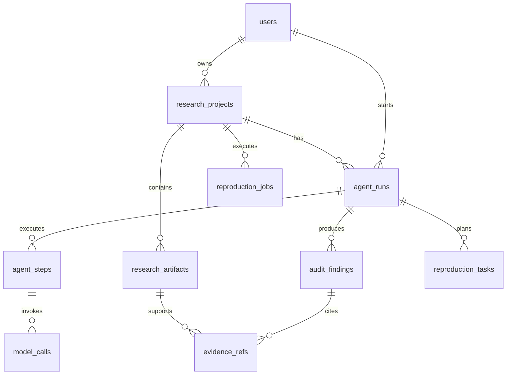

# ReproMind 数据库设计

## 设计原则

数据库沿用 EduAgent 的工程习惯：PostgreSQL、UUID 主键、`tenant_id` 租户隔离、异步 SQLAlchemy 会话、JSONB 扩展字段、必要索引，以及 LangGraph PostgreSQL Checkpointer。

ReproMind 使用独立的 `repromind` 数据库，不与 `eduagent` 的教育业务表混放，避免学习和调试两个项目时相互污染。

## 业务表关系



| 表 | 用途 | 关键字段 |
|---|---|---|
| `users` | 用户与租户身份预留 | `tenant_id`, `role`, `is_active` |
| `research_projects` | 论文复现项目 | `owner_id`, `research_domain`, `status` |
| `research_artifacts` | 论文、代码、配置、结果等证据 | `kind`, `object_key`, `sha256`, `metadata` |
| `agent_runs` | 一次多 Agent 任务 | `thread_id`, `goal`, `route`, `score`, `report` |
| `agent_steps` | Agent 执行轨迹 | `sequence_no`, `agent_type`, `model_role`, `duration_ms` |
| `model_calls` | 模型调用审计和 token 统计 | `provider`, `model_id`, `total_tokens`, `success` |
| `audit_findings` | 风险、验证项和建议 | `severity`, `category`, `status` |
| `evidence_refs` | 发现到原始证据的定位 | `artifact_id`, `locator`, `excerpt` |
| `reproduction_tasks` | 可执行复现步骤 | `step_no`, `inputs`, `expected_outputs`, `verification` |
| `reproduction_jobs` | 自主复现任务和实时进度 | `current_stage`, `progress`, `execution_command`, `events`, `logs` |

`agent_runs.report` 保留完整报告快照；规范化子表支持筛选、统计和追溯。两者并存，避免前端每次展示报告都进行复杂联表，同时也避免关键审计数据只存在于不可查询的 JSON 中。

## LangGraph 状态表

应用启动时由 `AsyncPostgresSaver.setup()` 幂等创建官方 checkpoint 表。它们与 `agent_runs.thread_id` 对应，但不承载业务报告：

- `checkpoints`
- `checkpoint_blobs`
- `checkpoint_writes`
- `checkpoint_migrations`

业务记录与图运行状态分离，便于中断恢复、故障排查和后续加入人工审批节点。

## 基础设施取舍

| 组件 | 当前状态 | 使用条件 |
|---|---|---|
| PostgreSQL | 已使用 | 业务数据、运行轨迹、checkpoint |
| Milvus | 已预留配置，暂未建 collection | 文档切片与语义检索上线时启用 |
| MinIO | 暂不使用 | 文件改为对象存储时启用；当前为本地目录 |
| Redis | 暂不使用 | 引入异步任务队列、分布式锁或热点缓存时启用 |
| etcd | 不由业务代码直接使用 | 仅作为 Milvus 依赖 |

这与“以业务为准”的原则一致：接口和配置位已经保留，但不会为了技术栈完整而制造无实际用途的依赖。

## 本地隧道映射

```text
127.0.0.1:15432 -> server 127.0.0.1:5432  PostgreSQL
127.0.0.1:29530 -> server 127.0.0.1:19530 Milvus
```

不要将数据库密码、MoMA token 写入仓库。连接参数仅放在本机 `.env` 或部署平台的密钥管理中。
